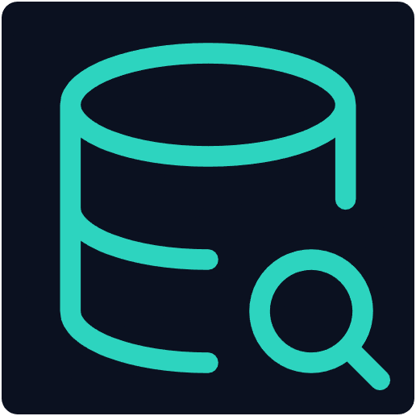

<p align="center">
  
</p>

<h1 align="center">QueryLens</h1>

<p align="center">
  Read-only PostgreSQL performance monitoring, in one self-hosted app.
</p>

<p align="center">
  <a href="#quick-start">Quick start</a> ·
  <a href="#documentation">Docs</a> ·
  <a href="docs/02-architecture.md">Architecture</a>
</p>

---

## What it does

- **Registers databases** and tests each connection before saving it; passwords
  are stored encrypted.
- **Collects statistics** from PostgreSQL system views (`pg_stat_database`,
  `pg_stat_activity`, tables, indexes and `pg_stat_statements`) on a fixed
  schedule, over read-only sessions.
- **Stores every collection unchanged** as an immutable snapshot.
- **Shows the data as plain tables** that refresh in place, plus a health page
  for QueryLens itself.

## Quick start

Requires Docker with Compose.

```bash
cp .env.example .env    # set POSTGRES_PASSWORD, the four secrets and APP_ORIGIN
docker compose up --build -d
docker compose run --rm migrate node scripts/create-admin.js --name "Ada Lovelace" --email ada@example.com
```

Open `http://localhost:8000` and sign in.

## Local development

Requires Node.js 22+, pnpm 11 and a PostgreSQL database.

```bash
pnpm install
cp .env.example .env.development.local    # point DATABASE_URL at your database
pnpm exec dotenv run -f .env.development.local -- drizzle-kit migrate
pnpm create-admin --name "Ada Lovelace" --email ada@example.com
pnpm dev                                  # server + Tailwind watcher
```

`pnpm typecheck` checks types; `pnpm build` and `pnpm start` run the production
build. See [`docs/03-setup.md`](docs/03-setup.md) for every setting.

## Documentation

| Guide                                                  | Covers                                                                 |
| ------------------------------------------------------ | ---------------------------------------------------------------------- |
| [`docs/01-overview.md`](docs/01-overview.md)           | Purpose, scope, capabilities and technology                            |
| [`docs/02-architecture.md`](docs/02-architecture.md)   | System structure, request pipeline, collection cycle and module layout |
| [`docs/03-setup.md`](docs/03-setup.md)                 | Requirements, configuration reference and quick start                  |
| [`docs/04-data-model.md`](docs/04-data-model.md)       | Metadata schema, storage approach and migrations                       |
| [`docs/05-collector.md`](docs/05-collector.md)         | How statistics are collected on a schedule                             |
| [`docs/06-api.md`](docs/06-api.md)                     | Endpoint reference with request and response schemas                   |
| [`docs/07-web.md`](docs/07-web.md)                     | Pages, layouts and client-side behaviour                               |
| [`docs/08-auth-security.md`](docs/08-auth-security.md) | Authentication, credential protection and security practices           |
| [`docs/09-health-errors.md`](docs/09-health-errors.md) | Platform health page and error pages                                   |
| [`docs/10-dev-guide.md`](docs/10-dev-guide.md)         | Project structure, migrations, deployment and limitations              |

## Built with

Node.js 22 · TypeScript · Hono · PostgreSQL with Drizzle ORM · Tailwind CSS v4 ·
Alpine.js · Docker
