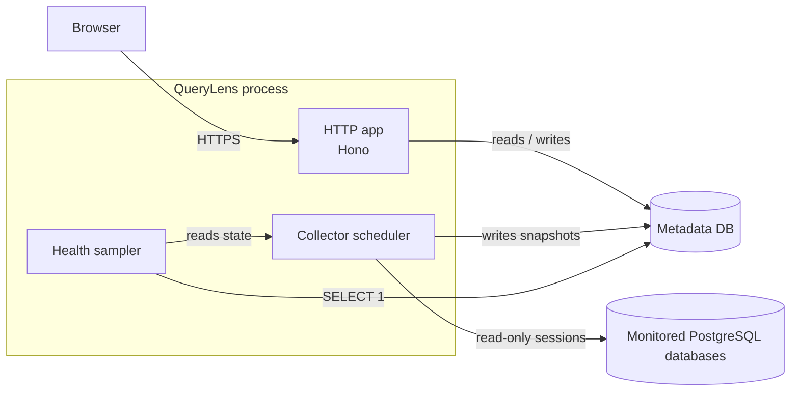
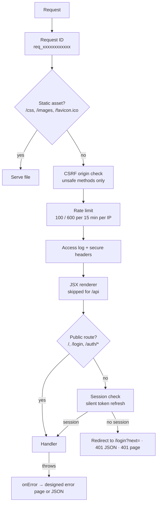
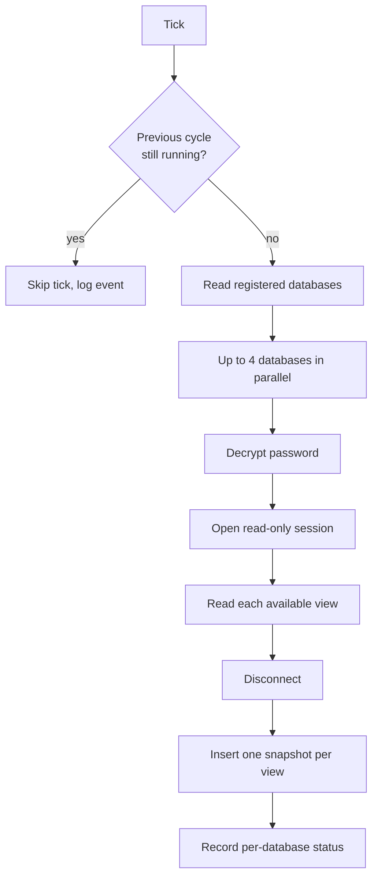
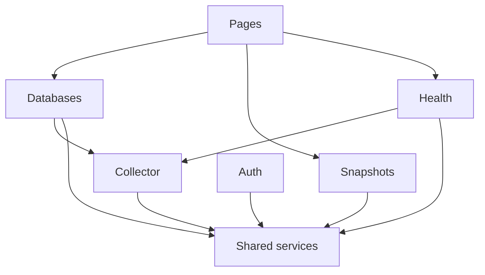

# 2. Architecture

## 2.1 System Structure

QueryLens is a single Node.js process containing four cooperating parts: a
server-rendered web interface, an HTTP request handler, a scheduled collector,
and a health sampler. It connects to its own **metadata database** and,
read-only, to each **monitored database**.

## 2.2 Components

| Component         | Location                                | Responsibility                                                                                     |
| ----------------- | --------------------------------------- | -------------------------------------------------------------------------------------------------- |
| HTTP application  | `src/app.ts`                            | Builds the Hono app: middleware, routes, error handlers. Has no side effects.                      |
| Process entry     | `src/index.ts`                          | Starts the HTTP server, the collector scheduler and the health sampler; handles graceful shutdown. |
| Web interface     | `src/modules/pages`, `src/shared/views` | Server-rendered pages, layouts and shared components.                                              |
| Collector         | `src/modules/collector`                 | Scheduled retrieval of statistics and storage of snapshots.                                        |
| Health            | `src/modules/health`                    | Checks of QueryLens's own services, 30-second sampling, `/health` page and JSON.                   |
| Metadata database | `src/shared/db`                         | Drizzle schema and the single connection pool.                                                     |

## 2.3 Request Pipeline

Every request passes through the same middleware chain, in this order:

Errors raised anywhere in the chain are converted by the global `onError` /
`notFound` handlers (`src/shared/middleware/errors.tsx`) into one of the seven
designed error pages for browsers, or a JSON error for API clients. Raw
framework error pages are never shown.

## 2.4 Collection Cycle

The scheduler runs one cycle immediately at start-up and then every interval.
Cycles never overlap: a tick that arrives while a cycle is still running is
skipped and recorded.

## 2.5 Module Layout

The application is organised by feature. Each module owns its routes, logic and
types.

| Module         | Path                    | Responsibility                                                                           |
| -------------- | ----------------------- | ---------------------------------------------------------------------------------------- |
| Authentication | `src/modules/auth`      | Sign-in, sign-out, login validation.                                                     |
| Databases      | `src/modules/databases` | Registration, connectivity testing, listing with status.                                 |
| Collector      | `src/modules/collector` | View list, per-database collection, scheduler, in-memory status.                         |
| Snapshots      | `src/modules/snapshots` | Read-only access to stored snapshots (`/api/views`, `/api/snapshots*`).                  |
| Health         | `src/modules/health`    | Platform checks, sampler, `/health` routes.                                              |
| Pages          | `src/modules/pages`     | Thin page compositions: login, databases, snapshots, health, error template.             |
| Shared         | `src/shared`            | Metadata access (`db`), utilities (`lib`), middleware, layouts and components (`views`). |

## 2.6 State

| State                                                                  | Where it lives                          | Survives restart                                     |
| ---------------------------------------------------------------------- | --------------------------------------- | ---------------------------------------------------- |
| Users, sessions, registered databases, snapshots                       | Metadata database                       | Yes                                                  |
| Last collection result per database (reachability, uptime, view count) | Collector memory (`collector/state.ts`) | No — databases show **Pending** until the next cycle |
| Scheduler timings, errors in the last hour                             | Scheduler memory                        | No                                                   |
| Health samples (40 per service) and internal events (200 max)          | Health sampler / event log memory       | No                                                   |
| Rate-limit counters                                                    | Limiter memory                          | No                                                   |

## 2.7 Boundaries

| Boundary          | Responsibility                                | Constraint                                                                      |
| ----------------- | --------------------------------------------- | ------------------------------------------------------------------------------- |
| Metadata access   | Reads and writes to the metadata database.    | Only through `src/shared/db/client.ts`.                                         |
| Target collection | Reads statistics from monitored databases.    | Read-only sessions with 5 s connect and 10 s statement timeouts; always closed. |
| Request handling  | Serves pages and JSON to authenticated users. | Credentials never appear in responses, pages or logs.                           |
| Health reporting  | Reports on QueryLens itself.                  | Never displays monitored-database statistics.                                   |

---
