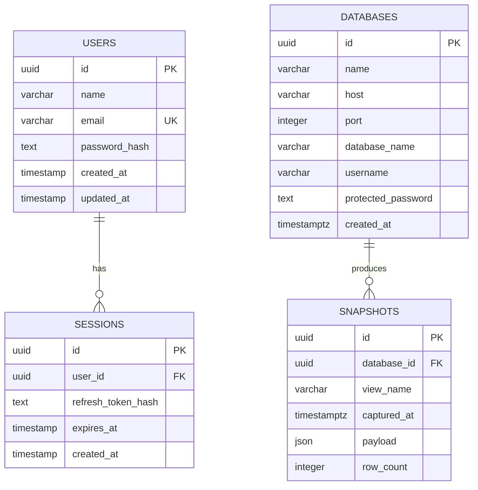

# 4. Data Model

## 4.1 Overview

QueryLens stores four kinds of records in its metadata database. The schema is
defined in one place, `src/shared/db/schema.ts`, and applied through the
migrations in `drizzle/`.

## 4.2 Tables

### `users`

| Column                     | Type                  | Notes                                                |
| -------------------------- | --------------------- | ---------------------------------------------------- |
| `id`                       | `uuid` PK             | `gen_random_uuid()`                                  |
| `name`                     | `varchar(100)`        | Shown as initials in the top bar.                    |
| `email`                    | `varchar(255)` unique | Sign-in identifier.                                  |
| `password_hash`            | `text`                | bcrypt hash (cost 15); the password is never stored. |
| `created_at`, `updated_at` | `timestamp(3)`        |                                                      |

### `sessions`

| Column               | Type                   | Notes                                                             |
| -------------------- | ---------------------- | ----------------------------------------------------------------- |
| `id`                 | `uuid` PK              | Carried inside both JWTs as `sessionId`.                          |
| `user_id`            | `uuid` FK → `users.id` | `ON DELETE CASCADE`.                                              |
| `refresh_token_hash` | `text`                 | SHA-256 of the current refresh token; replaced on every rotation. |
| `expires_at`         | `timestamp`            | Sliding 7-day expiry, extended on rotation.                       |
| `created_at`         | `timestamp`            |                                                                   |

### `databases`

| Column               | Type           | Notes                                                                                                                                                 |
| -------------------- | -------------- | ----------------------------------------------------------------------------------------------------------------------------------------------------- |
| `id`                 | `uuid` PK      |                                                                                                                                                       |
| `name`               | `varchar(100)` | Display name; duplicates are allowed.                                                                                                                 |
| `host`               | `varchar(255)` | Hostname or IP.                                                                                                                                       |
| `port`               | `integer`      | Default `5432`.                                                                                                                                       |
| `database_name`      | `varchar(63)`  |                                                                                                                                                       |
| `username`           | `varchar(63)`  |                                                                                                                                                       |
| `protected_password` | `text`         | AES-256-GCM ciphertext, format `v1.<iv>.<tag>.<ciphertext>` (see [§8.2](08-auth-security.md#82-credential-protection)). Never selected by read paths. |
| `created_at`         | `timestamptz`  |                                                                                                                                                       |

### `snapshots`

| Column        | Type                       | Notes                                                                     |
| ------------- | -------------------------- | ------------------------------------------------------------------------- |
| `id`          | `uuid` PK                  |                                                                           |
| `database_id` | `uuid` FK → `databases.id` | `ON DELETE CASCADE`.                                                      |
| `view_name`   | `varchar(63)`              | One of the configured views ([§5.3](05-collector.md#53-collected-views)). |
| `captured_at` | `timestamptz`              | Identical for every view collected in the same cycle.                     |
| `payload`     | `json`                     | Array of row objects exactly as returned by the view.                     |
| `row_count`   | `integer`                  | `payload.length`.                                                         |

Index `snapshots_database_view_captured_idx` on
`(database_id, view_name, captured_at DESC)` serves "latest snapshot per view"
queries.

## 4.3 Storage Approach

Each snapshot stores one view's rows as a single JSON document rather than as
columns. Any PostgreSQL system view can therefore be stored without a dedicated
table, and the data is preserved without transformation:

- The column type is `json`, not `jsonb`, so key order — and therefore the
  view's column order — is kept exactly.
- Values keep PostgreSQL's representation: integers, floats, numerics, OIDs and
  transaction IDs become JSON numbers (unless they exceed 2^53, which stay as
  text); booleans become JSON booleans; timestamps, intervals, `inet`, arrays
  and all other types keep PostgreSQL's text format.
- At most 1,000 rows are stored per view per cycle.

Snapshots are **append-only**: existing records are never modified. There is no
automatic retention; storage grows by roughly five rows per database per
interval. Plan disk capacity or external pruning accordingly.

## 4.4 Migrations

| Migration                                              | Creates                                  |
| ------------------------------------------------------ | ---------------------------------------- |
| `20261103135916_create users and sessions tables`      | `users`, `sessions`                      |
| `20261117091822_create databases and snapshots tables` | `databases`, `snapshots`, snapshot index |

See [§10.5](10-dev-guide.md#105-working-with-the-data-model) for generating and
applying migrations.

---
