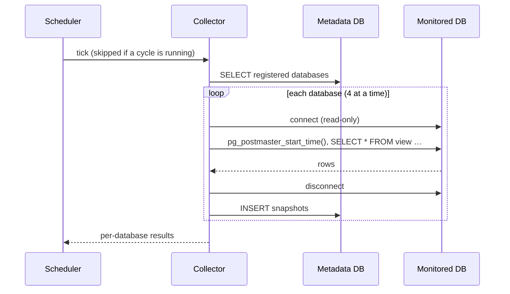

# 5. Collector

## 5.1 Purpose

The collector retrieves statistics from every registered database and stores
them as snapshots. It runs on a fixed schedule inside the QueryLens process and
requires no user interaction.

## 5.2 Operation

`startScheduler()` (called by `src/index.ts` once the HTTP server is listening)
runs one cycle immediately and then one every `COLLECTION_INTERVAL_SECONDS`.
Each cycle:

1. Reads all registered databases from the metadata database.
2. Collects up to **4 databases in parallel**. For each database:
   1. Decrypts the stored password.
   2. Opens a **read-only** session (`default_transaction_read_only=on`,
      `application_name=querylens`, 5 s connect timeout, 10 s statement
      timeout).
   3. Reads `pg_postmaster_start_time()` (used for the Uptime metric).
   4. Reads each configured view, skipping views that are unavailable.
   5. Closes the session.
   6. Inserts one snapshot per collected view, all sharing the same
      `captured_at`.
   7. Records the result (reachable, uptime, number of views, or a safe failure
      reason) in memory.

## 5.3 Collected Views

Defined in `src/modules/collector/views.ts`, in display order:

| View                   | Information          | Query                                                          | Availability                                    |
| ---------------------- | -------------------- | -------------------------------------------------------------- | ----------------------------------------------- |
| `pg_stat_database`     | Database statistics  | `SELECT * FROM pg_stat_database`                               | Always                                          |
| `pg_stat_activity`     | Session activity     | `SELECT * FROM pg_stat_activity WHERE pid <> pg_backend_pid()` | Always (other users' queries need `pg_monitor`) |
| `pg_stat_user_tables`  | Table statistics     | `SELECT * FROM pg_stat_user_tables`                            | Always                                          |
| `pg_stat_user_indexes` | Index statistics     | `SELECT * FROM pg_stat_user_indexes`                           | Always                                          |
| `pg_stat_statements`   | Statement statistics | `SELECT * FROM pg_stat_statements`                             | Only when the extension is installed            |

Every query is limited to 1,000 rows. A view is **omitted for the cycle** — and
collection continues — when its availability check fails or the query fails with
"undefined table" (`42P01`), "insufficient privilege" (`42501`), "object not in
prerequisite state" (`55000`), "feature not supported" (`0A000`) or "undefined
function" (`42883`). Other query errors are logged and the view is omitted.

## 5.4 Safeguards

| Safeguard                 | Implementation                                                                                                                                                                          |
| ------------------------- | --------------------------------------------------------------------------------------------------------------------------------------------------------------------------------------- |
| Overlap prevention        | A tick that fires while a cycle is still running is skipped, counted, and logged as an internal "Tick skipped" event. Ticks stay anchored to the schedule.                              |
| Per-database isolation    | Each database is collected independently; a failure is recorded for that database only.                                                                                                 |
| Graceful omission         | Unavailable views are skipped without failing the database.                                                                                                                             |
| Connection cleanup        | Sessions are closed in a `finally` block; shutdown waits up to 10 s for an in-flight cycle.                                                                                             |
| Read-only access          | Sessions are read-only; PostgreSQL rejects any write (`25006`).                                                                                                                         |
| Safe errors               | Failures are reduced to short reasons ("Connection refused", "Authentication failed", "Database does not exist", …); credentials and raw server messages are never logged or displayed. |
| Undecryptable credentials | If the stored password can't be decrypted (for example after `ENCRYPTION_KEY` changed), the database is marked unreachable with an explicit reason.                                     |

## 5.5 Status Reporting

| Signal                                                                                                                 | Consumer                                                                                                                     |
| ---------------------------------------------------------------------------------------------------------------------- | ---------------------------------------------------------------------------------------------------------------------------- |
| Per-database status: reachable, last checked, server start time, views collected, last error                           | `/app/databases` cards and `GET /api/databases` (`state`: `connected`, `unreachable`, or `pending` before the first attempt) |
| Scheduler snapshot: active, running, last tick, next run, drift, average duration, errors in the last hour, last error | `/health` Collectors and Scheduler cards                                                                                     |
| Internal events: scheduler started / resumed, tick skipped, cycle failed, database became unreachable / recovered      | `/health` Recent Internal Events (logged on status _changes_ only)                                                           |

Status is held in memory and resets on restart.

## 5.6 Configuration

| Setting                     | Source                                      | Default        |
| --------------------------- | ------------------------------------------- | -------------- |
| Interval                    | `COLLECTION_INTERVAL_SECONDS`               | 60 s (10–3600) |
| Parallel databases          | `CONCURRENCY` in `collector/service.ts`     | 4              |
| Rows per view               | `MAX_ROWS_PER_VIEW` in `collector/views.ts` | 1000           |
| Connect / statement timeout | `shared/lib/pg-client.ts`                   | 5 s / 10 s     |

---
