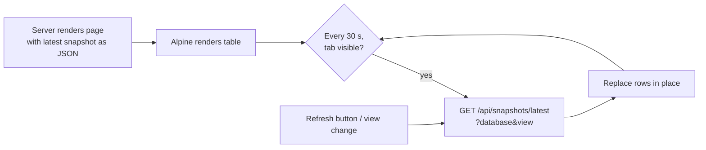

# 7. Web Interface

## 7.1 Purpose

The web interface gives access to registered databases, collected statistics and
platform health through server-rendered pages with limited client-side
interaction.

## 7.2 Pages

| Page            | Route            | Layout             | Implementation                    |
| --------------- | ---------------- | ------------------ | --------------------------------- |
| Sign in         | `/login`         | `AuthLayout`       | `modules/pages/LoginPage.tsx`     |
| Databases       | `/app/databases` | `AppLayout`        | `modules/pages/DatabasesPage.tsx` |
| Snapshots       | `/app/snapshots` | `AppLayout`        | `modules/pages/SnapshotsPage.tsx` |
| Platform health | `/health`        | `AppLayout`        | `modules/pages/HealthPage.tsx`    |
| Error pages     | any failure      | `StandaloneLayout` | `modules/pages/ErrorPage.tsx`     |

Layouts live in `src/shared/views/layouts/`:

| Layout             | Description                                                                                                                         |
| ------------------ | ----------------------------------------------------------------------------------------------------------------------------------- |
| `Document`         | `<html>`/`<head>`: Inter + JetBrains Mono (Google Fonts), `/css/styles.css`, Alpine components and Alpine.js 3.14.9 from jsDelivr.  |
| `AppLayout`        | 56 px sticky top bar, 240 px sidebar (64 px icon-only at 768–1023 px, drawer below 768 px), content area max 1440 px, toast region. |
| `AuthLayout`       | Full-viewport centred column with a faint accent glow.                                                                              |
| `StandaloneLayout` | Error pages: wordmark linking to `/app/databases`, centred 520 px column, status-coloured glow.                                     |

## 7.3 Interaction

Pages are rendered on the server. Alpine.js is used only for:

| Interaction                                                                            | Where                   |
| -------------------------------------------------------------------------------------- | ----------------------- |
| Password reveal toggle                                                                 | Sign in, register modal |
| Submit-button loading ring                                                             | Sign in                 |
| Register modal: open/close, Test Connection, Register, list refresh                    | Databases               |
| View selection, polling, manual refresh, "Updated Ns ago" ticker                       | Snapshots               |
| Database pill dropdown with search                                                     | Snapshots (top bar)     |
| 30 s auto-refresh countdown, diagnostic / last-error / resume modals, copy status JSON | Health                  |
| 429 countdown and 503 auto-retry                                                       | Error pages             |
| Avatar menu, mobile navigation drawer, toasts                                          | App shell               |

Shared Alpine components (`passwordReveal`, `copyable`, `dropdown`, `modal`,
`$store.toasts`) are registered in `shared/views/components/ClientScripts.tsx`.
Page-specific components are registered by an inline script on the page that
uses them.

### Snapshot polling

Polling pauses while the tab is hidden and fetches immediately when it becomes
visible again if 30 s have passed. Polling only reads stored snapshots; it never
triggers a collection.

### In-place refresh

The databases page (after registering) and the health page (every 30 s) refetch
their own HTML and replace a region of the DOM (`#databases-region`,
`#health-live`), so server rendering stays the single source of markup. The
health page skips the swap while a modal is open.

## 7.4 Display

Collected statistics are displayed as a table whose columns come from the first
row's keys, so any collected view displays without a dedicated page. Headers are
the keys in Title Case. Columns whose values are numbers are right-aligned in
monospace; identifiers, timestamps, intervals, sizes and query text are set in
monospace; other text uses Inter.

| State                                 | Shown when                                                                            |
| ------------------------------------- | ------------------------------------------------------------------------------------- |
| Table                                 | The latest snapshot of the view has rows.                                             |
| "This view returned no rows"          | The latest snapshot is empty.                                                         |
| Skeleton (5 rows)                     | A view change is loading.                                                             |
| "No snapshots collected yet"          | The database has no snapshots at all.                                                 |
| "View not available on this database" | Other views exist but not this one (e.g. `pg_stat_statements` without the extension). |
| "Couldn't load snapshots." + Retry    | A fetch failed; any data already shown stays visible.                                 |

## 7.5 Components and Styling

Every component is a typed function in `src/shared/views/components/`: `Button`,
`Input`, `PasswordInput`, `Select`/`Dropdown`, `StatusBadge`, `StatusDot`,
`Card`, `DataTable`, `CodeBlock`, `Modal`, `Toast`, `EmptyState`, `Skeleton`,
`SegmentedControl`, `Toggle`, `TimelineStrip`, `StatusBanner`, plus `Icon`
(inlined Lucide), `Logo`, `MetricRow`, `TopBar`, `Sidebar`, `DatabasePill`.

Design tokens are CSS custom properties in `src/global.css`, mapped into
Tailwind v4 through an `@theme inline` block (for example `bg-surface`,
`text-fg-muted`, `border-line`, `text-2xs`, `tracking-label`, `shadow-overlay`).
Tailwind's default colour palette is removed, so only tokens are available and
no hex colour appears in JSX.

## 7.6 Accessibility

- 2 px orange focus ring with 2 px offset on every focusable element (global
  `:focus-visible`).
- Status is always dot + label + colour; badges and banners that update use
  `role="status"` / `aria-live="polite"`.
- Modals trap focus, close on Esc, focus the first field, and return focus to
  the trigger.
- Decorative icons are `aria-hidden`; icon-only buttons have `aria-label`.
- Form errors use `aria-invalid` and `aria-describedby`; the sign-in error uses
  `role="alert"`.
- A "Skip to content" link precedes the app shell.

---
