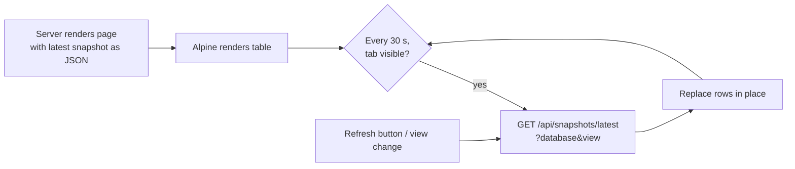

# 7. Web Interface

## 7.1 Purpose

The web interface gives access to registered databases, collected statistics and
platform health through server-rendered pages with limited client-side
interaction.

## 7.2 Pages

| Page            | Route            | Layout             | Implementation                    |
| --------------- | ---------------- | ------------------ | --------------------------------- |
| Sign in         | `/login`         | `AuthLayout`       | `modules/pages/LoginPage.tsx`     |
| Databases       | `/app/databases` | `AppLayout`        | `modules/pages/DatabasesPage.tsx` |
| Snapshots       | `/app/snapshots` | `AppLayout`        | `modules/pages/SnapshotsPage.tsx` |
| Platform health | `/health`        | `AppLayout`        | `modules/pages/HealthPage.tsx`    |
| Error pages     | any failure      | `StandaloneLayout` | `modules/pages/ErrorPage.tsx`     |

Layouts live in `src/shared/views/layouts/`:

| Layout             | Description                                                                                                                         |
| ------------------ | ----------------------------------------------------------------------------------------------------------------------------------- |
| `Document`         | `<html>`/`<head>`: Inter + JetBrains Mono (Google Fonts), favicon, `/css/styles.css`, `/js/app.js` and the page's entry module.     |
| `AppLayout`        | 56 px sticky top bar, 240 px sidebar (64 px icon-only at 768–1023 px, drawer below 768 px), content area max 1440 px, toast region. |
| `AuthLayout`       | Full-viewport centred column on the app background; no decoration.                                                                  |
| `StandaloneLayout` | Error pages: logo linking to `/app/databases`, centred 520 px column on the app background.                                         |

## 7.3 Interaction

Pages are rendered on the server. Alpine.js is used only for:

| Interaction                                                                            | Where                   |
| -------------------------------------------------------------------------------------- | ----------------------- |
| Password reveal toggle                                                                 | Sign in, register modal |
| Submit-button loading ring                                                             | Sign in                 |
| Register modal: open/close, Test Connection, Register, list refresh                    | Databases               |
| View selection, polling, manual refresh, "Updated Ns ago" ticker                       | Snapshots               |
| Database pill dropdown with search                                                     | Snapshots (top bar)     |
| 30 s auto-refresh countdown, diagnostic / last-error / resume modals, copy status JSON | Health                  |
| 429 countdown and 503 auto-retry                                                       | Error pages             |
| Avatar menu, mobile navigation drawer, toasts                                          | App shell               |

All client code lives in ES modules under `public/js/` (§7.4); pages contain no
inline scripts.

### Snapshot polling



Polling pauses while the tab is hidden and fetches immediately when it becomes
visible again if 30 s have passed. Polling only reads stored snapshots; it never
triggers a collection.

### In-place refresh

The databases page (after registering) and the health page (every 30 s) refetch
their own HTML and replace a region of the DOM (`#databases-region`,
`#health-live`), so server rendering stays the single source of markup. The
health page skips the swap while a modal is open.

## 7.4 Client Modules

Client behaviour is plain JavaScript served as ES modules from `public/js/`,
with no build step. Alpine.js 3.14.9 is imported from jsDelivr's ESM build in
one place, `vendor/alpine.js`.

```text
public/js/
├── app.js                       # every page: registers shared components, starts Alpine
├── vendor/alpine.js             # the only Alpine import (version pin)
├── lib/                         # framework-free helpers
│   ├── dom.js                   # focusable elements, visibility, in-place region swaps
│   ├── http.js                  # getJson / postJson / getHtml with sign-in redirect on 401
│   └── time.js                  # relativeTime()
├── components/                  # shared Alpine components (used by shared JSX components)
│   ├── app-shell.js             # appShell — mobile nav drawer
│   ├── copyable.js              # copyable — copy to clipboard
│   ├── dropdown.js              # dropdown — Select, database pill, avatar menu
│   ├── modal.js                 # modal(id) — dialogs, focus trap
│   ├── password-reveal.js       # passwordReveal
│   └── toasts.js                # $store.toasts, toastRegion
├── features/                    # page behaviour, one folder per feature
│   ├── auth/login-form.js                     # loginForm
│   ├── databases/register-database.js         # registerDatabase({ modalId, openOnLoad })
│   ├── snapshots/snapshot-viewer.js           # snapshotViewer(configId)
│   ├── snapshots/columns.js                   # column derivation and cell formatting
│   ├── health/health-page.js                  # healthPage({ refreshSeconds, … })
│   └── errors/error-page.js                   # errorPage({ countdown, autoRetry, mode })
└── pages/                       # one entry per page: registers that page's components
    ├── login.js  databases.js  snapshots.js  health.js  error.js
```

| Rule          | Detail                                                                                                                                                                                                      |
| ------------- | ----------------------------------------------------------------------------------------------------------------------------------------------------------------------------------------------------------- |
| Loading       | `Document` emits `<script type="module">` for `/js/app.js`, then the page entry named by the layout's `script` prop (`PAGE_SCRIPTS` in `src/shared/views/assets.ts`). Common modules are `modulepreload`ed. |
| Start-up      | Module scripts run in document order before `DOMContentLoaded`; `app.js` calls `Alpine.start()` on that event, so every component is registered first.                                                      |
| Factories     | Files in `components/` and `features/` export plain factory functions and never import Alpine; only `app.js` and `pages/*` register them.                                                                   |
| Server values | Passed as arguments in `x-data`, built with `alpineData("name", options)`; large initial data (snapshots) goes in a `<script type="application/json">` block.                                               |
| Toasts        | Components call `this.$store.toasts.push(type, message)`; server-queued toasts use the region's `data-initial` attribute.                                                                                   |
| Production    | `/js/*` is served from `public/js` in development and `dist/public/js` in production; the Docker build and `scripts/build.js` copy it there.                                                                |

To add behaviour to a page: write a factory in `features/<feature>/`, register
it in that page's entry under `pages/`, and reference it from JSX with
`x-data={alpineData("name", options)}`. For a new page, add its entry to
`PAGE_SCRIPTS` and pass it to the layout's `script` prop.

## 7.5 Display

Collected statistics are displayed as a table whose columns come from the first
row's keys, so any collected view displays without a dedicated page. Headers are
the keys in Title Case. Columns whose values are numbers are right-aligned in
monospace; identifiers, timestamps, intervals, sizes and query text are set in
monospace; other text uses Inter.

| State                                 | Shown when                                                                            |
| ------------------------------------- | ------------------------------------------------------------------------------------- |
| Table                                 | The latest snapshot of the view has rows.                                             |
| "This view returned no rows"          | The latest snapshot is empty.                                                         |
| Skeleton (5 rows)                     | A view change is loading.                                                             |
| "No snapshots collected yet"          | The database has no snapshots at all.                                                 |
| "View not available on this database" | Other views exist but not this one (e.g. `pg_stat_statements` without the extension). |
| "Couldn't load snapshots." + Retry    | A fetch failed; any data already shown stays visible.                                 |

## 7.6 Components and Styling

Every component is a typed function in `src/shared/views/components/`: `Button`,
`Input`, `PasswordInput`, `Select`/`Dropdown`, `StatusBadge`, `StatusDot`,
`Card`, `DataTable`, `CodeBlock`, `Modal`, `Toast`, `EmptyState`, `Skeleton`,
`SegmentedControl`, `Toggle`, `TimelineStrip`, `StatusBanner`, `Icon`, `Logo`,
`MetricRow`, `TopBar`, `Sidebar`, `DatabasePill`, plus `ClientScripts` (the
module `<script>` tags).

Every public path the server uses — stylesheet, fonts, logo, favicon, icon
folder, client scripts and the static folders — is defined once in
`src/shared/views/assets.ts`.

### Midnight Teal tokens

The palette is defined once, in the `@theme` block of `src/global.css`. Each
token is both a Tailwind utility and a CSS variable (`var(--color-app)`).
Tailwind's default palette is removed, so only these colours exist and no hex
value appears in JSX. Tailwind reads class names only from `src/` and
`public/js/` (`@source` in `global.css`), so local and Docker builds produce the
same CSS.

| Group       | Tokens (utility examples)                                                                                                                                                                     |
| ----------- | --------------------------------------------------------------------------------------------------------------------------------------------------------------------------------------------- |
| Brand       | `brand-100` #CCFBF1, `brand-400` #2DD4BF (links, selected nav text), `brand-600` #0D9488 (primary, focus), `brand-700` #0F766E (primary hover), `brand-900` #134E4A (selected nav background) |
| Backgrounds | `bg-app` #0B1120, `bg-sidebar` #0F172A, `bg-surface` #111827, `bg-elevated` #1E293B, `bg-table-header`, `bg-hover`, `bg-input`                                                                |
| Text        | `text-text-primary` #F1F5F9, `text-text-secondary` #94A3B8, `text-text-muted` #64748B, `text-text-inverse` #FFFFFF                                                                            |
| Borders     | `border-border` #334155, `border-border-subtle` #1E293B, `border-border-focus` #0D9488, `border-border-hover`                                                                                 |
| Status      | `success`, `warning`, `danger`, `info` (+ `-bg` variants such as `bg-success-bg`), `inactive`                                                                                                 |

Usage: primary buttons `bg-brand-600 text-text-inverse hover:bg-brand-700`;
links `text-brand-400`; active navigation `bg-brand-900 text-brand-400`; cards
and dividers `border-border-subtle`; inputs, popovers and secondary buttons
`border-border`; status colours only for status, never as decoration.

### Logo

The official mark is `public/images/querylens.webp` with
`public/images/querylens.png` as fallback. `LogoMark` renders it in a
`<picture>`; `Logo` adds the "QueryLens" wordmark, since the asset contains
none. The files are served directly and never modified.

The favicon lives on its own in `public/favicon/favicon.png` (linked from
`Document`; `/favicon.ico` redirects to it).

| Folder                 | Contents                                                 |
| ---------------------- | -------------------------------------------------------- |
| `public/favicon/`      | `favicon.png` only                                       |
| `public/images/`       | images used by the UI: `querylens.webp`, `querylens.png` |
| `public/images/icons/` | one `.svg` file per icon                                 |

### Icons

Each icon is a standalone `.svg` file in `public/images/icons/` (24×24 outline,
`stroke="currentColor"`, stroke 1.8, round caps and joins). A single component,
`Icon` (`src/shared/views/components/Icon.tsx`), renders all of them:

```tsx
<Icon name="database" size={16} />
<Icon name="alert-triangle" size={32} class="text-warning" label="Warning" />
```

`Icon` reads every file listed in `ICON_NAMES` once at start-up (from `public/`
in development, `dist/public/` in production) and inlines its paths inside its
own `<svg>`. Inlining, rather than ``, lets icons inherit the
surrounding text colour (teal in the active nav, red for errors). A missing or
malformed file stops start-up instead of rendering a blank icon.

Default size is 20 (16 inline, 24 large, 32 for empty states and banners).
Components that take an icon accept its name: `<Button icon="plus">`. Pass
`label` for a meaningful icon; otherwise it is `aria-hidden`. To add an icon,
add `public/images/icons/<name>.svg` and its name to `ICON_NAMES`.

## 7.7 Accessibility

- 2 px teal (`border-focus`) focus ring with 2 px offset on every focusable
  element (global `:focus-visible`).
- Status is always dot + label + colour; badges and banners that update use
  `role="status"` / `aria-live="polite"`.
- Modals trap focus, close on Esc, focus the first field, and return focus to
  the trigger.
- Decorative icons are `aria-hidden`; icon-only buttons have `aria-label`.
- Form errors use `aria-invalid` and `aria-describedby`; the sign-in error uses
  `role="alert"`.
- A "Skip to content" link precedes the app shell.

---
