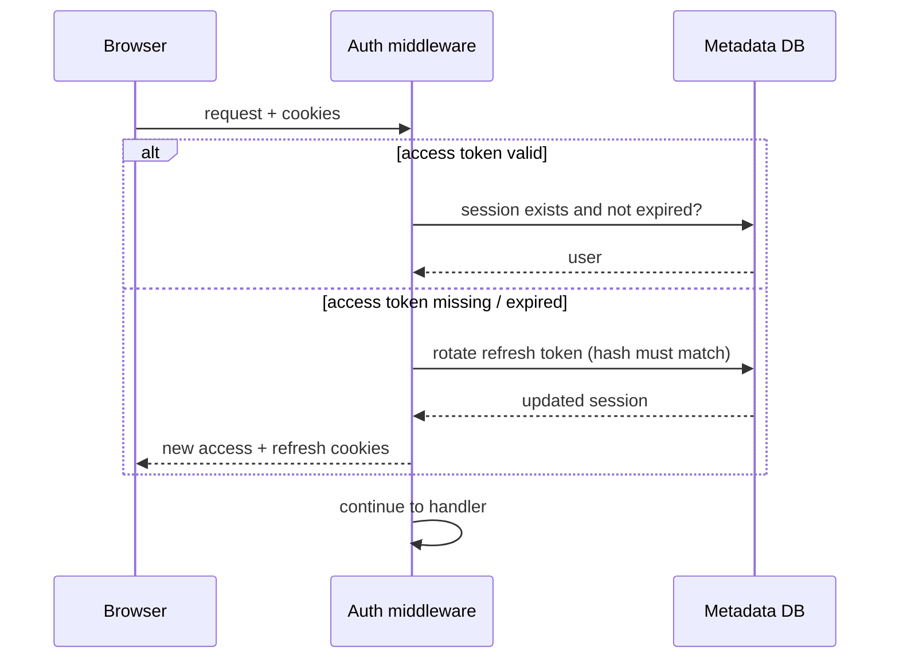

# 8. Authentication and Security

## 8.1 Authentication

QueryLens requires a signed-in user for every page and data endpoint except the
sign-in page.

| Aspect            | Implementation                                                                                                                                                                                                                                                            |
| ----------------- | ------------------------------------------------------------------------------------------------------------------------------------------------------------------------------------------------------------------------------------------------------------------------- |
| Accounts          | Created by an operator with `pnpm create-admin` ([§10.4](10-dev-guide.md#104-common-tasks)); there is no sign-up page. Passwords must be 8–20 characters with upper case, lower case, a digit and a special character.                                                    |
| Sign-in           | `POST /auth/login` verifies the bcrypt hash. Unknown emails take the same time as wrong passwords, so response time doesn't reveal which accounts exist.                                                                                                                  |
| Session           | A `sessions` row plus two signed, HTTP-only cookies: `access_token` (JWT, 15 min) and `refresh_token` (JWT, 7 days). Both JWTs carry the user ID and session ID.                                                                                                          |
| Silent refresh    | When the access token is missing or expired, the middleware verifies the refresh token, **rotates** it (one-time use: its SHA-256 hash must match the session row, and every token carries a unique `jti`), issues a new access token, and extends the session by 7 days. |
| Without a session | Page `GET` → `302 /login?next=<path>`; `/api/*` or JSON → `401`; other page requests → the 401 error page.                                                                                                                                                                |
| Sign-out          | `POST /auth/logout` deletes the session row and clears both cookies.                                                                                                                                                                                                      |
| Return path       | `next` accepts only same-origin relative paths; `//host`, `/\host`, absolute URLs, `/login` and `/auth/*` fall back to `/app/databases`.                                                                                                                                  |

## 8.2 Credential Protection

| Item                          | Protection                                                                                                                                                                                                                                                                                                                                   |
| ----------------------------- | -------------------------------------------------------------------------------------------------------------------------------------------------------------------------------------------------------------------------------------------------------------------------------------------------------------------------------------------- |
| Registered database passwords | AES-256-GCM with a fresh 96-bit IV per value and an authentication tag; key derived from `ENCRYPTION_KEY` with HKDF-SHA256. Stored as `v1.<iv>.<tag>.<ciphertext>`. Decrypted only immediately before connecting to that database; tampered values are rejected. Never selected by read paths, returned by an endpoint, rendered, or logged. |
| User account passwords        | bcrypt, cost 15.                                                                                                                                                                                                                                                                                                                             |
| Refresh tokens                | Only a SHA-256 hash is stored.                                                                                                                                                                                                                                                                                                               |
| Session cookies               | Signed with `COOKIES_SECRET`; `HttpOnly`, `SameSite=Lax`, `Path=/`, and `Secure` when `NODE_ENV=production`.                                                                                                                                                                                                                                 |

## 8.3 Security Practices

| Practice               | Implementation                                                                                                                                                     |
| ---------------------- | ------------------------------------------------------------------------------------------------------------------------------------------------------------------ |
| Read-only monitoring   | Monitoring sessions use `default_transaction_read_only=on`; PostgreSQL rejects writes.                                                                             |
| No credential exposure | Connection errors are reduced to fixed reasons; the health payload redacts secret-looking keys as `••••`; error pages show only status, request ID, time and path. |
| CSRF protection        | Unsafe methods require `Origin` equal to `APP_ORIGIN`; cross-site `Sec-Fetch-Site` values are refused.                                                             |
| Rate limiting          | Per IP per 15 min: 100 requests without a session cookie, 600 with one (static assets exempt). Sign-in: 15 attempts per 30 min.                                    |
| Security headers       | Hono `secureHeaders()` (frame, content-type, referrer and cross-origin policies).                                                                                  |
| Script embedding       | Server data embedded in pages escapes `<`, U+2028 and U+2029.                                                                                                      |
| Request tracing        | Server-generated request IDs (client-supplied IDs are ignored) appear in logs and on error pages.                                                                  |
| Scope control          | Only registered databases are contacted.                                                                                                                           |

## 8.4 Operational Notes

- Use distinct, random values for all four secrets; rotating `COOKIES_SECRET` or
  a JWT secret signs every user out.
- **Never rotate `ENCRYPTION_KEY`** after databases are registered; there is no
  re-encryption tool.
- Serve QueryLens over HTTPS in production and set `APP_ORIGIN` to the HTTPS
  origin.
- Rate-limit counters, collection status and health history are kept in memory
  per process; run a single instance.

---
