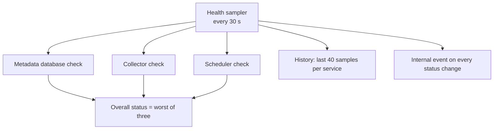

# 9. Health and Error Pages

## 9.1 Platform Health

The platform health page (`/health`) reports the state of QueryLens itself. It
is distinct from the statistics pages, which report on monitored databases, and
it never shows monitored-database data.

### Services and thresholds

| Service           | Healthy                                                               | Degraded                                                               | Critical                      | Metrics shown                                                                    |
| ----------------- | --------------------------------------------------------------------- | ---------------------------------------------------------------------- | ----------------------------- | -------------------------------------------------------------------------------- |
| Metadata database | `SELECT 1` succeeds in < 250 ms and no client is waiting for the pool | ≥ 250 ms or clients waiting                                            | Fails or exceeds 3 s          | Connection, latency, pool used/max                                               |
| Collector         | Last cycle succeeded and completed within 2 × interval                | No completed cycle in > 2 × interval (**Stale**), or scheduler stopped | Last cycle threw (**Failed**) | Databases collected, last tick, errors in the last hour, average tick, next tick |
| Scheduler         | Active, drift ≤ 5 s                                                   | Stopped (**Paused**) or drift > 5 s                                    | —                             | State, interval, drift, next run, process uptime                                 |

Errors in the last hour count every failed database collection, so an
unreachable monitored database raises the count without making the collector
unhealthy.

### Page behaviour

| Element                              | Behaviour                                                                                                                                                              |
| ------------------------------------ | ---------------------------------------------------------------------------------------------------------------------------------------------------------------------- |
| Banner                               | "All systems operational" / "Partial degradation detected" / "Platform is down", with `{healthy}/3 services healthy · checked …`.                                      |
| Service cards                        | Status badge, metrics, inline message and action for degraded states (Retry now, View last error, Resume), timeline of the last 40 samples.                            |
| Recent Internal Events               | Events from the last hour (newest first, up to 50): scheduler started / resumed, tick skipped, cycle failed, database unreachable / recovered, service status changes. |
| Auto-refresh                         | Every 30 s with a draining countdown bar; the page content is replaced in place.                                                                                       |
| Refresh                              | Runs the checks immediately (`?check=1`).                                                                                                                              |
| Run full diagnostic / Health payload | Modal with the redacted JSON payload ([§6.6](06-api.md#66-health)).                                                                                                    |
| Copy status JSON                     | Copies the payload to the clipboard.                                                                                                                                   |
| Resume                               | Shown only when the scheduler is stopped; asks for confirmation, then calls `POST /health/scheduler/resume`.                                                           |

In normal operation the scheduler is started with the process and never stops;
the Paused state appears only if it has been stopped. If the metadata database
is down, `/health` itself cannot load (signing in needs the database) and the
503 page is shown instead.

## 9.2 Error Pages

Every failure is rendered as one of seven designed pages for browsers, or as a
JSON error ([§6.1](06-api.md#61-conventions)) for API clients. Other statuses
map to the closest page: other `4xx` → 400, other `5xx` → 500.

| Status | Typical trigger                    | Primary action                                              | Secondary action  |
| ------ | ---------------------------------- | ----------------------------------------------------------- | ----------------- |
| 400    | Malformed request body             | Go back                                                     | Copy request ID   |
| 401    | Form post without a session        | Sign in (preserving `next`)                                 | Go back           |
| 403    | Missing or foreign `Origin` header | Go to dashboard                                             | Go back           |
| 404    | Unknown path                       | Go to dashboard                                             | Go back           |
| 429    | Rate limit exceeded                | Try again (disabled until the `Retry-After` countdown ends) | Go back           |
| 500    | Unexpected error                   | Reload page                                                 | Copy request ID   |
| 503    | Metadata database unreachable      | Retry (automatic after 3 s)                                 | Check status page |

Each page shows the status code, a short label, a title, a description, the
actions, and a reference strip with **Request ID**, **Time** (UTC) and **Path**.
The 500 and 503 pages add a collapsible **Details** block containing only the
status, the error class or reason, and the request ID — never stack traces, SQL,
secrets or file paths.

Retry-style actions reload only after a `GET`; after a `POST` they go back
instead, so a form is never resubmitted.

Every unhandled error is logged with its request ID, method and path, so a
reported reference can be found in `error-<date>.log`.

---
